# DICOM Viewer

## Overview

DICOM Viewer is a lightweight web viewer for local DICOM folders, written in
Python with [Reflex](https://reflex.dev). Point it at a folder tree, open a
series, and look at it one image at a time or cut three ways, with windowing
presets, the image metadata, and any annotations stored beside the images:
segmentations, structure sets, measurement reports and presentation states.

It is meant to be friendly to people new to DICOM. Every windowing preset
says what it is for and has a short tutorial, the folder page tells you
which folders hold images, and the layout works on a phone as well as on a
desktop.

## Features

- **Folder browser** rooted at your DICOM folder: breadcrumbs, the number
  of images and annotations in each folder, the series label, one-click
  Open. The last folder you visited is remembered.
- **One view**: slice slider, mouse wheel and arrow keys, zoom and pan,
  window level and width sliders, an Auto window and 31 presets grouped by
  body region, each with a description and a tutorial in English, 繁體中文,
  简体中文 and Español.
- **Three views (MPR)**: axial, coronal and sagittal cuts around one
  crosshair. Click a view to move the crosshair, scroll a view to step
  through it.
- **Annotations**: SEG, RTSTRUCT, SR measurement reports and presentation
  states (PR) found next to the series are drawn on the images and listed
  in a panel; every layer and every segment or ROI can be switched off, and
  the opacity is adjustable.
- **Metadata panel**, with the patient name, ID and study date hidden
  behind a password.
- **Responsive**: the side panels fold into drawers on narrow screens, and
  three views become tabs on a phone.

## Usage Guide

### 1) Choose a folder

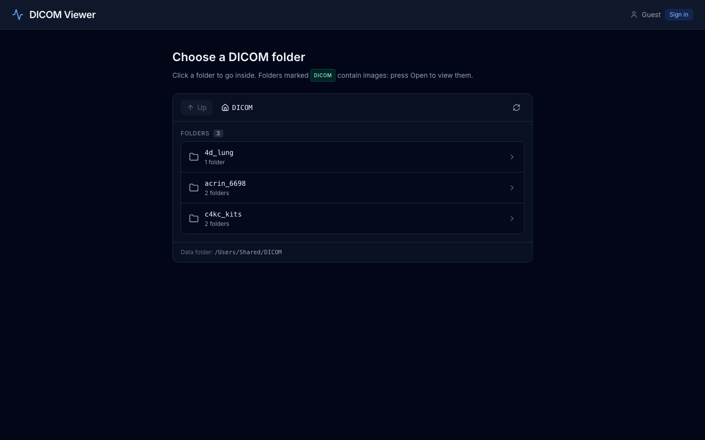

The app opens on your DICOM folder (see [Configuration](#configuration)).
Click a folder to go inside. Folders that hold images say how many, with the
series label; folders that hold annotation objects say that instead. Use
the breadcrumb or **Up** to go back.

### 2) Open a series

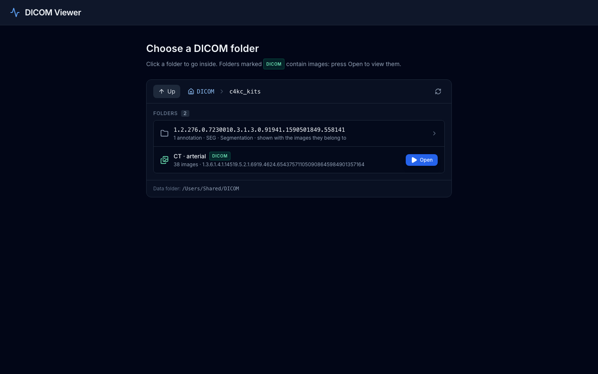

Inside a collection, each series sits in its own folder, the layout data
portals such as the Imaging Data Commons produce. Press **Open** on a folder
with images. A folder holding an annotation object (here a SEG) is listed
too; its annotations are shown together with the images they belong to.

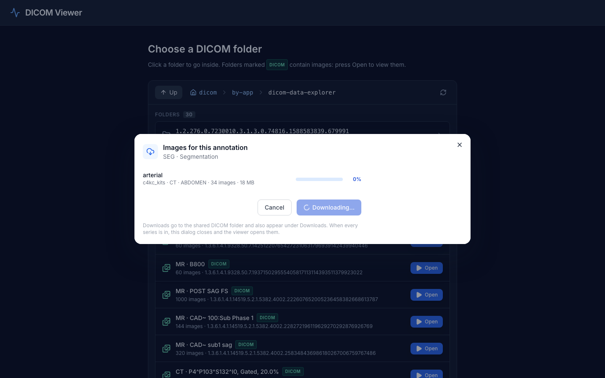

An annotation folder's row offers **Open** when the images it belongs to
are downloaded (they are opened with the annotation on top), and **Get
images** when they are not: that button opens [DICOM Data Explorer](https://github.com/milochen0418/dicom_data_explorer)
in a dialog (a DDNS Intent), listing the series the annotation refers to.
Download them there; as soon as they are in, the dialog closes and the viewer
opens the series with the annotation on top. This needs both apps installed
in the App Store; on a developer machine see [Configuration](#configuration).

### 3) The viewer

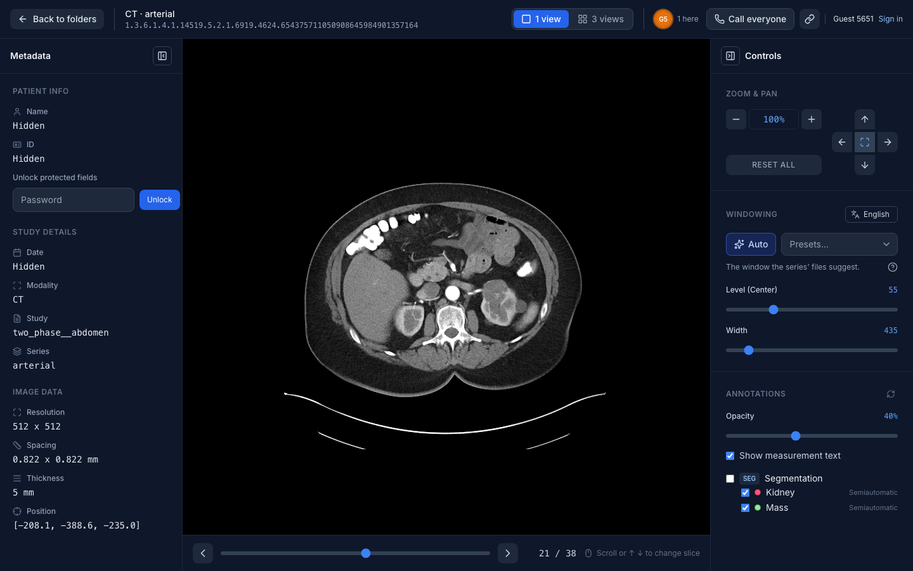

Left, the metadata of the image on screen (protected fields unlock with the
password). Centre, the image and the slice bar. Right, the controls: zoom
and pan, windowing, presets and annotations.

Moving through the series:

| Action | Keys / mouse |
|---|---|
| Next or previous slice | mouse wheel over the image, ↓ ↑ or → ← |
| Ten slices at a time | Page Down / Page Up |
| Any slice | the slider under the image |
| Zoom and pan | the buttons under Zoom & Pan; Reset All restores the view and the window |

### 4) Windowing: Auto and presets

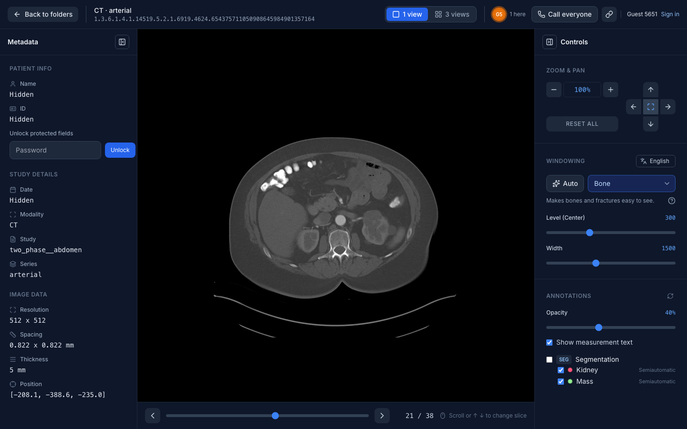

A series opens on **Auto**: the window its files suggest or, when they
suggest none, one worked out from the image's own values. The **Presets**
list sets the window for a common tissue (soft tissue, lung, bone, brain,
...), grouped by body region; on a phone it opens the phone's own picker.
The line under it says what the window in use is for, in the language
chosen beside the Windowing heading, and **?** opens a short tutorial in
that language. The Level and Width sliders set the window by hand.

**Auto** goes back to the window the series opened with, after a preset or
the sliders. Reset All does the same and also resets zoom and pan.

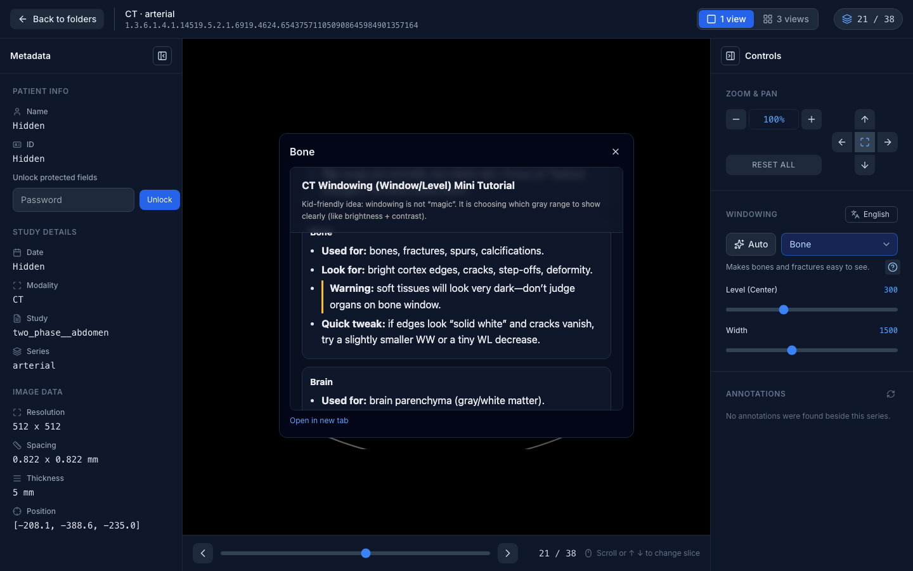

### 5) Three views

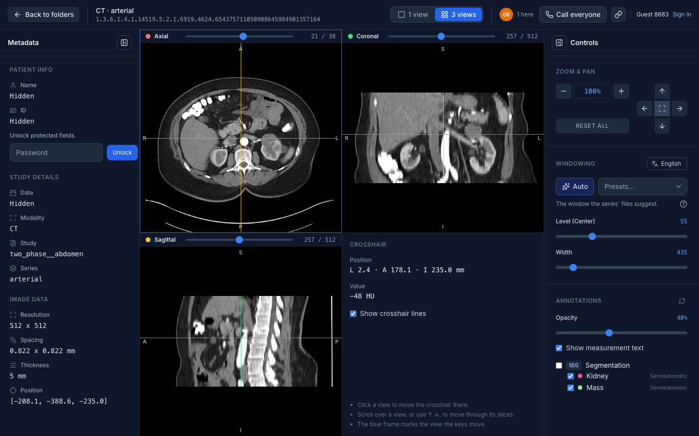

**3 views** stacks the series into a volume and cuts it axially, coronally
and sagittally around one crosshair. Click a view to move the crosshair
there; scroll over a view, or use ↑ ↓, to step through its slices. The
crosshair panel shows the position in patient millimetres and the pixel
value (in HU for CT). Switching back to **1 view** shows the scanned image
the crosshair is on.

### 6) Annotations

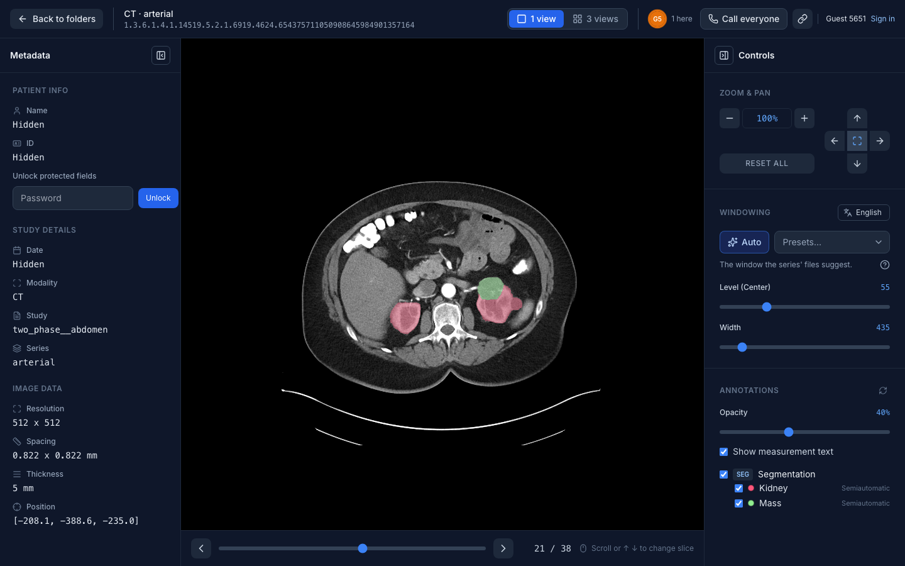

Annotation objects stored beside the images are drawn on them and listed in
the Annotations section of the controls:

- **SEG** (DICOM Segmentation): one colour per segment, in 1 view and 3 views.
- **RTSTRUCT** (RT Structure Set): ROI outlines in 1 view, filled in 3 views.
- **SR** (TID 1500 measurement reports): measured regions with their values.
- **PR** (Softcopy Presentation States): graphics and text, in 1 view.

Each layer and each segment or ROI has its own switch, the opacity slider
applies to all of them, and the refresh button looks for annotation files
again after you download some. Annotations made for another series in the
same frame of reference are drawn where the images line up.

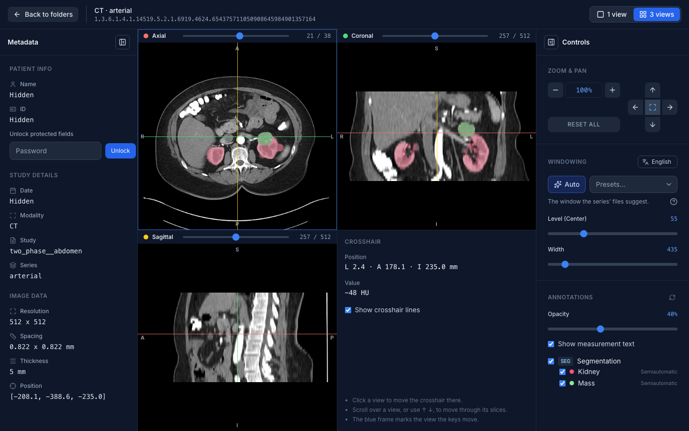

The interface behind this, and how to add a format, is described in
[docs/annotations_interface.md](docs/annotations_interface.md).

### 7) On a phone

<p>
  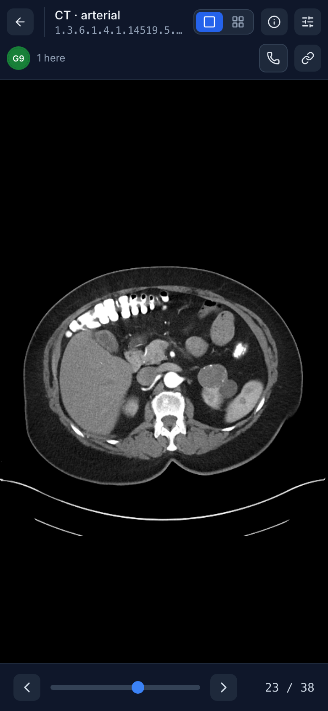
  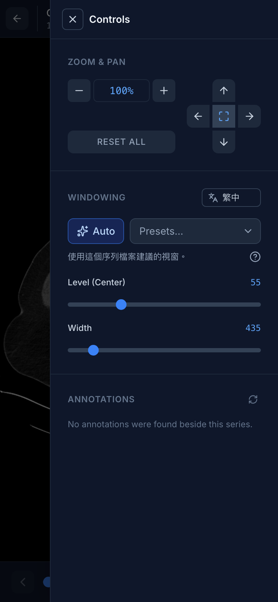
  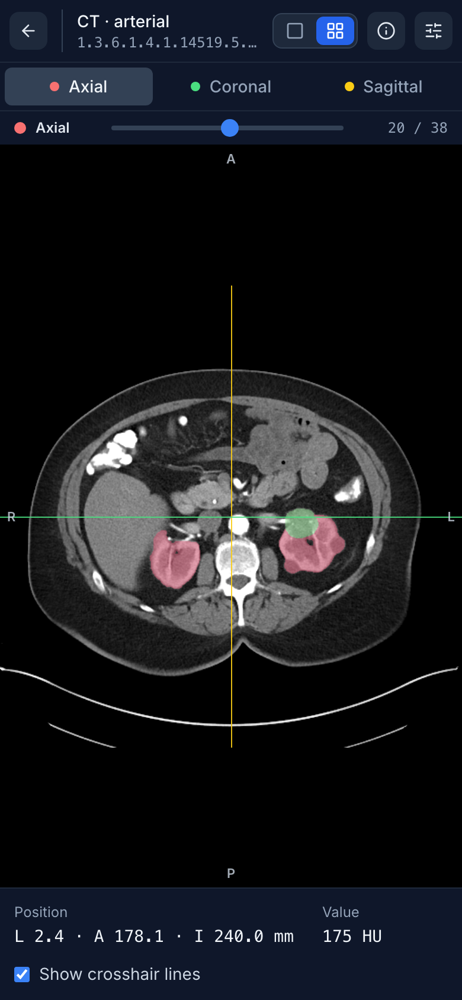
</p>

Below the desktop width the Metadata and Controls panels open as drawers
from the buttons in the top bar, and three views show one plane at a time,
with tabs to switch.

## Configuration

| Environment variable | Default | Meaning |
|---|---|---|
| `PUBLIC_DICOM_DIR` | `/Users/Shared/DICOM` on macOS (or wherever that folder exists), else your home folder | The folder the browser starts in. Nothing above it can be opened. |
| `DICOM_METADATA_PASSWORD` | `dicom` | Unlocks the patient name, ID and study date in the metadata panel. |
| `DDNS_INTENT_URL_DICOM_DATA_EXPLORER` | `https://dicom-data-explorer.reflex-ddns.com` | Where **Get images** opens DICOM Data Explorer; point it at a local copy (e.g. `http://localhost:3100`) when developing. |
| `DDNS_INTENT_TRUST_LOCALHOST` | unset | `1` lets the two apps talk when both run on localhost. |

**Get images** is available when the viewer is installed with the
`reflex_ddns_auth` library (the App Store does this); without it the button
is simply not shown.

## Data

- DICOM Part 10 files (with the `DICM` preamble). Grayscale and RGB images
  are shown. The Auto window is the one the file suggests, or, without one,
  the 1st to 99th percentile of a middle slice, the lowest value (usually
  the background) left out. Compressed transfer syntaxes need `pylibjpeg` (with `pylibjpeg-libjpeg`)
  or `gdcm` installed in the environment.
- Keep one series per folder. Annotation objects are found in the series
  folder and in the folders beside it.
- Three views need at least two parallel slices of one size with position
  information; series over 768 MB are refused.

## Design Documents

- [DICOM Viewer — Software Design Document (SDD).pdf](docs/DICOM%20Viewer%20%E2%80%94%20Software%20Design%20Document%20%28SDD%29.pdf):
  the overall architecture and key design decisions.
- [Annotation display interface](docs/annotations_interface.md): how SEG,
  SR, RTSTRUCT and GSPS annotations reach the screen through one interface,
  and how to write an adapter for a new format.

Contributions are welcome. Open an issue with feedback or ideas, or submit
a PR to improve the app or the documentation.

## Getting Started

This project is managed with [Poetry](https://python-poetry.org/).

### Prerequisites

- Python 3.11.x
- Poetry

### Installation

1. Ensure Poetry uses Python 3.11:

```bash
poetry env use python3.11
poetry env info
```

2. Install dependencies:

```bash
poetry install
```

### Running the App

Start the development server:

```bash
poetry run ./reflex_rerun.sh
```

The application will be available at `http://localhost:3000`.

### Running the Tests

Unit tests live under `tests/` and run without starting the app:

```bash
poetry run pytest
```

## Project Layout

| Path | What it holds |
|---|---|
| `dicom_viewer/folders.py` | The folder page's view of the disk: listing, DICOM detection, image and annotation counts |
| `dicom_viewer/series.py` | Reading a series: slice order, the file's window, rendering to PNG |
| `dicom_viewer/volume.py` | Stacking a series into a volume and cutting it for three views |
| `dicom_viewer/annotations/` | The annotation interface and the SEG, SR, RTSTRUCT and PR adapters |
| `dicom_viewer/states/` | Reflex state: the folder page and the viewer |
| `dicom_viewer/components/` | The pages: folder browser, viewer, three views |
| `assets/tutorials/` | The windowing tutorials in four languages |
| `tests/` | Unit tests (`poetry run pytest`) |
