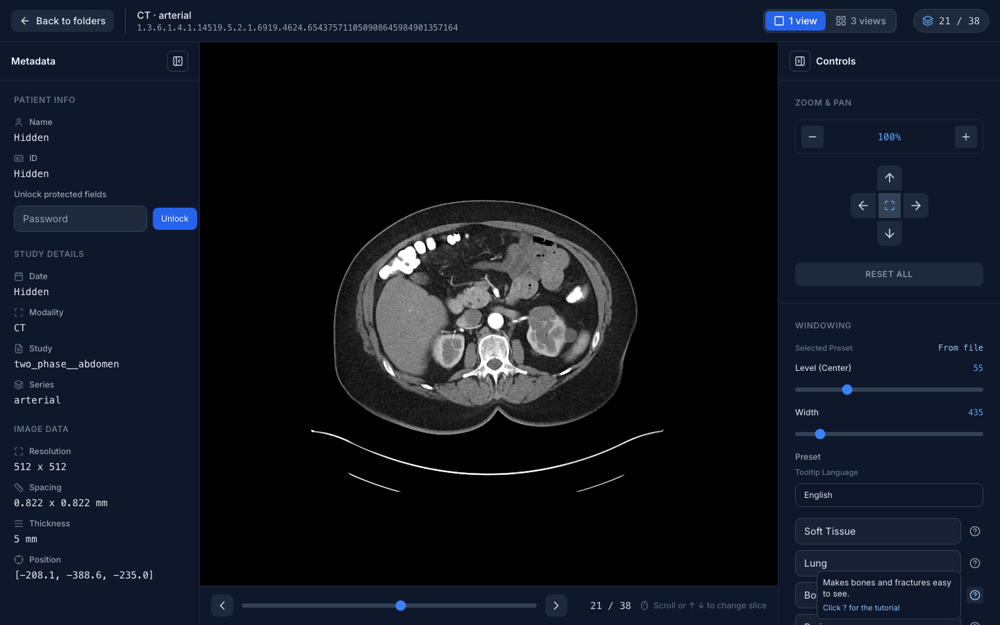
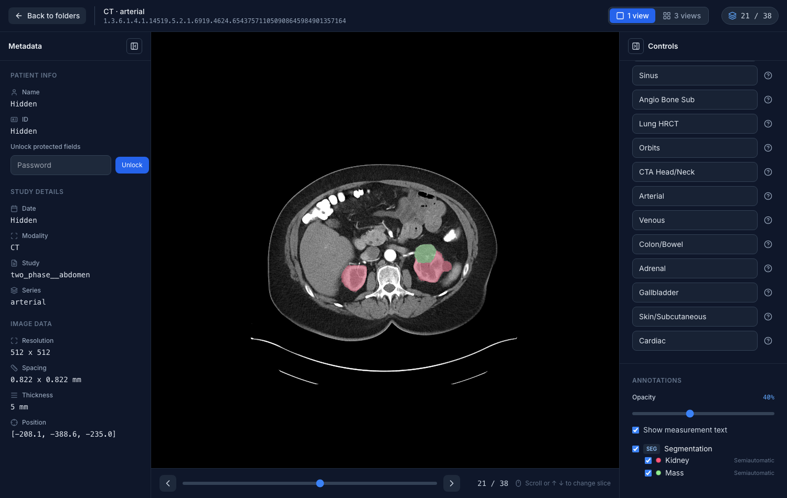

# DICOM Viewer

## Overview

DICOM Viewer is a lightweight image viewer designed for browsing local DICOM folders. It lets you scan and select a DICOM directory, quickly load images into the viewer, and apply common presets to adjust visualization for easier inspection and comparison.

This project is designed to be beginner-friendly for people new to DICOM, and this README includes a complete, step-by-step usage guide (including how to use presets).

## Design Document

We maintain a Software Design Document (SDD) to capture the overall architecture and key design decisions:

- [DICOM Viewer — Software Design Document (SDD).pdf](docs/DICOM%20Viewer%20%E2%80%94%20Software%20Design%20Document%20%28SDD%29.pdf)
- [Annotation display interface](docs/annotations_interface.md): how SEG, SR, RTSTRUCT and GSPS annotations reach the screen through one interface, and how to write an adapter for a new format.

Contributions are welcome—feel free to open an issue with feedback/ideas, or submit a PR to improve the app or the documentation.


## Usage Guide 

The steps below follow the actual workflow and reference every image under docs/images/ to help you quickly understand and use the product.

### 1) Launch Screen


When you open the app, you will see the initial screen prompting you to choose a DICOM source.

### 2) Scan a DICOM Directory


Click the “scan” or “load” action to start searching for a local DICOM directory.

### 3) Locate the Target Folder


In the file picker, navigate to a folder that contains DICOM files.

### 4) Select the DICOM Folder


Confirm the folder and click “Select”/“Open” to load the images from that directory.

### 5) Open the Viewer


After loading finishes, click the corresponding item to open the viewer.

### 6) Viewer Screen


The viewer provides image browsing and common presets for different visualization settings.

### 7) Preset Tooltip



Hover over a preset button to see its tooltip and learn what each preset does.


### 8) Annotations



Annotation objects stored beside the images are drawn on them and listed in
the Annotations section of the controls sidebar:

- **SEG** (DICOM Segmentation): one colour per segment, in 1 view and 3 views.
- **RTSTRUCT** (RT Structure Set): ROI outlines in 1 view, filled in 3 views.
- **SR** (TID 1500 measurement reports): measured regions with their values.
- **PR** (Softcopy Presentation States): graphics and text, in 1 view.

Put the annotation files in the series folder or in a folder beside it (the
one-series-per-folder layout data portals produce). Each layer and each
segment or ROI can be switched off, and the opacity is adjustable. The folder
page shows how many annotations a folder holds. The interface behind this is
described in [docs/annotations_interface.md](docs/annotations_interface.md).

## Getting Started

This project is managed with [Poetry](https://python-poetry.org/).

### Prerequisites

- Python 3.11.x
- Poetry


### Installation

1. Ensure Poetry uses Python 3.11:

```bash
poetry env use python3.11
poetry env info
```

2. Install dependencies:

```bash
poetry install
```

### Running the App

Start the development server:

```bash
poetry run ./reflex_rerun.sh
```

The application will be available at `http://localhost:3000`.

### Running the Tests

Unit tests live under `tests/` and run without starting the app:

```bash
poetry run pytest
```
